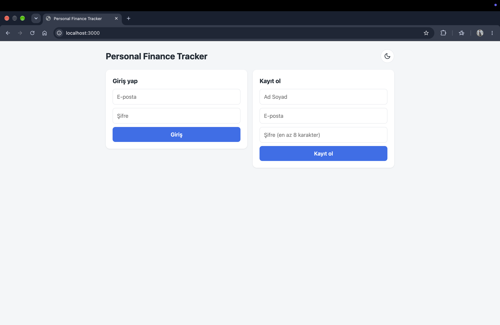
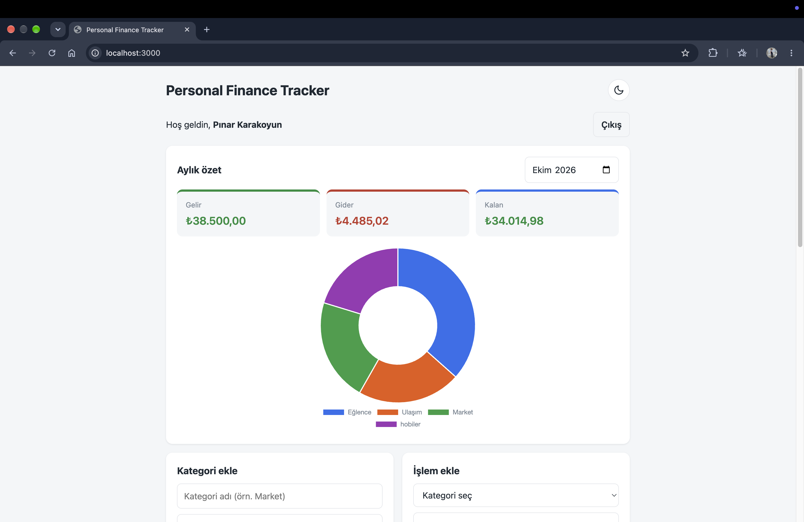
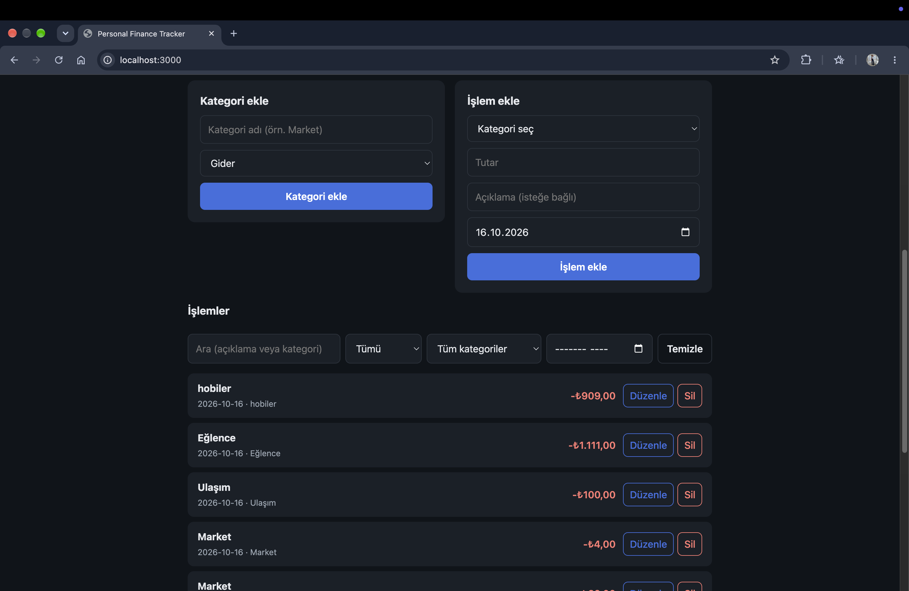

# Personal Finance Tracker

A full-stack web app for tracking personal income and expenses, with monthly summaries and a spending chart.

I built it as a learning project to practice the whole chain: **browser → REST API → database**, including user authentication.

## Features

- User registration and login (JWT authentication)
- Create income and expense categories
- Add, edit and delete transactions
- Search, filter (type, category, month) and paginate transactions
- Monthly summary: total income, total expenses and balance
- Doughnut chart of expenses by category
- Light and dark theme: follows the system by default, with a toggle button
- Responsive layout
- Each user can only access their own data

## Screenshots







## Tech Stack

| Layer | Technology |
|---|---|
| Frontend | HTML, CSS, vanilla JavaScript, Chart.js |
| Backend | Node.js, Express |
| Database | Microsoft SQL Server (running in Docker) |
| Auth | JSON Web Tokens (JWT), bcrypt |


## Project Structure

```
personal-finance-tracker/
├── database/schema.sql     # table definitions
├── middleware/auth.js      # JWT verification
├── routes/                 # auth, categories, transactions, summary
├── utils/month.js          # shared month-range helper
├── public/                 # frontend (HTML, CSS, JS)
├── docs/screenshots/       # images used in this README
├── db.js                   # database connection pool
└── server.js               # app entry point
```

Data model: `Users` 1 ── N `Categories` 1 ── N `Transactions` (a transaction also stores its owner's user id).

## API

All endpoints except `register`, `login` and `health` require the header `Authorization: Bearer <token>`.

| Method | Endpoint | Description |
|---|---|---|
| POST | `/api/auth/register` | Create an account |
| POST | `/api/auth/login` | Log in, returns a JWT |
| GET | `/api/categories` | List own categories |
| POST | `/api/categories` | Create a category |
| GET | `/api/transactions` | List own transactions (query: `q`, `type`, `categoryId`, `month`, `page`, `pageSize`) |
| POST | `/api/transactions` | Create a transaction |
| PUT | `/api/transactions/:id` | Update a transaction |
| DELETE | `/api/transactions/:id` | Delete a transaction |
| GET | `/api/summary?month=YYYY-MM` | Monthly totals and per-category breakdown |
| GET | `/api/health` | Health check |

`GET /api/transactions` returns `{ items, total, page, pageSize, totalPages }`. `pageSize` is capped at 50.

Example:

```bash
curl -X POST http://localhost:3000/api/auth/login \
  -H "Content-Type: application/json" \
  -d '{"email":"you@example.com","password":"your-password"}'
```

## Getting Started

### Prerequisites

- Node.js
- Docker (for SQL Server)

### 1. Start SQL Server

```bash
docker run --platform linux/amd64 \
  -e "ACCEPT_EULA=Y" \
  -e "MSSQL_SA_PASSWORD=YourStrong!Passw0rd" \
  -p 1433:1433 --name sql-finance \
  -d mcr.microsoft.com/mssql/server:2022-latest
```

`--platform linux/amd64` is needed on Apple Silicon Macs.

### 2. Create the database

Connect with any SQL client (for example Azure Data Studio) as user `sa`, then run:

```sql
CREATE DATABASE FinanceTracker;
```

Then run the script in `database/schema.sql` to create the tables.

### 3. Configure environment variables

```bash
cp .env.example .env
```

Open `.env`, set `DB_PASSWORD` to the SQL Server password from step 1, and set `JWT_SECRET` to a long random string. One way to generate it:

```bash
node -e "console.log(require('crypto').randomBytes(32).toString('hex'))"
```

### 4. Install and run

```bash
npm install
npm run dev
```

Open http://localhost:3000 and register an account.

## Security Notes

- Passwords are hashed with bcrypt and never stored in plain text.
- All SQL uses parameterized queries to prevent SQL injection, including the dynamic search and filter query.
- Every query filters by the authenticated user's id (taken from the token, not from the request), so users cannot read or change each other's data.
- User-provided text is inserted into the page with `textContent` to prevent XSS.
- The login endpoint returns the same error for a wrong email and a wrong password.
- Secrets live in `.env`, which is excluded from version control.
- Request inputs are validated and bounded (for example, `pageSize` is capped).

## Known Limitations

- The JWT is stored in `localStorage`; `httpOnly` cookies would be safer.
- No rate limiting on login attempts.
- No HTTPS configuration (intended for local development).
- No automated tests yet.
- Categories cannot be renamed or deleted yet.
- No password reset or email verification.

## What I Learned

- This was the first time I built a complete application from start to finish. I already knew some of the pieces, such as SQL, from university courses, but this was the first time I combined everything: SQL Server, an Express API and a browser frontend.
- Authentication was the hardest part. I learned the flow (hash the password with bcrypt, issue a signed JWT on login, verify it on every request).
- Debugging taught me to read error messages carefully and change one thing at a time. For example, a duplicated element id silently hid a whole section of the page.

## Future Improvements

- Monthly budgets per category
- Rename and delete categories
- Automated tests
- Rate limiting and security headers
- Docker Compose for one-command setup
- Cloud deployment